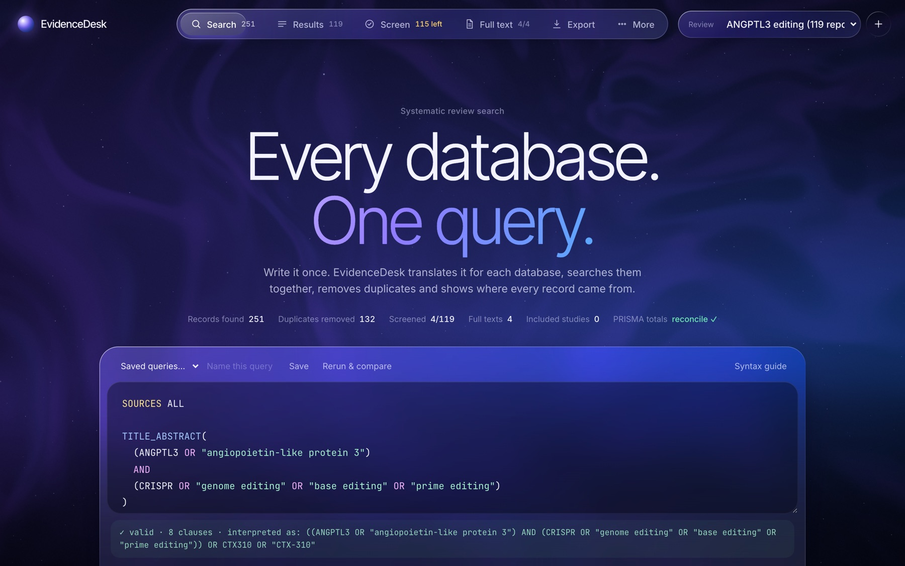
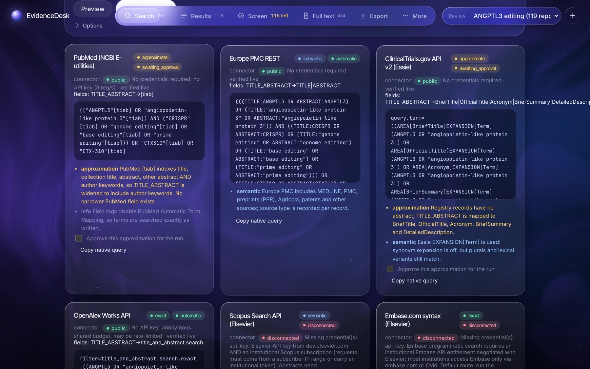
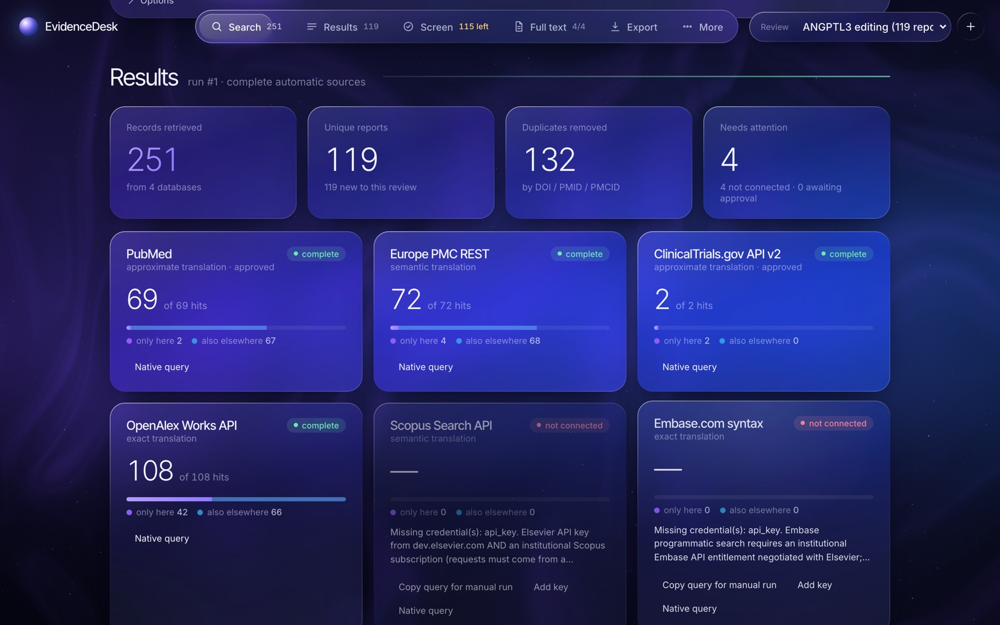
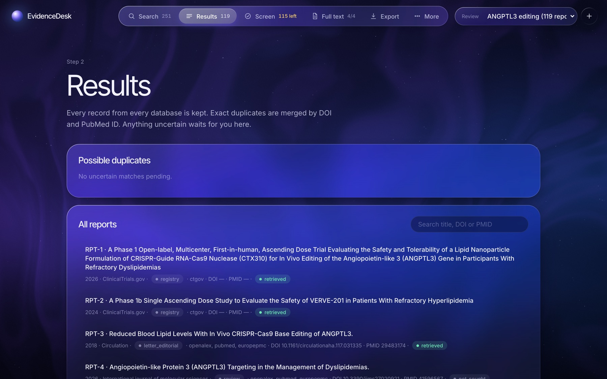
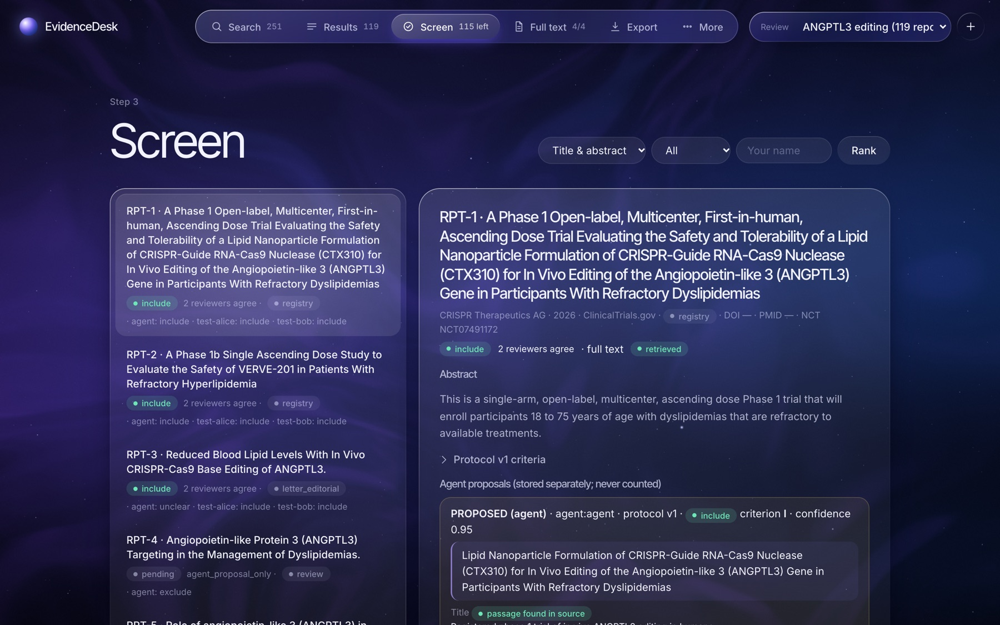
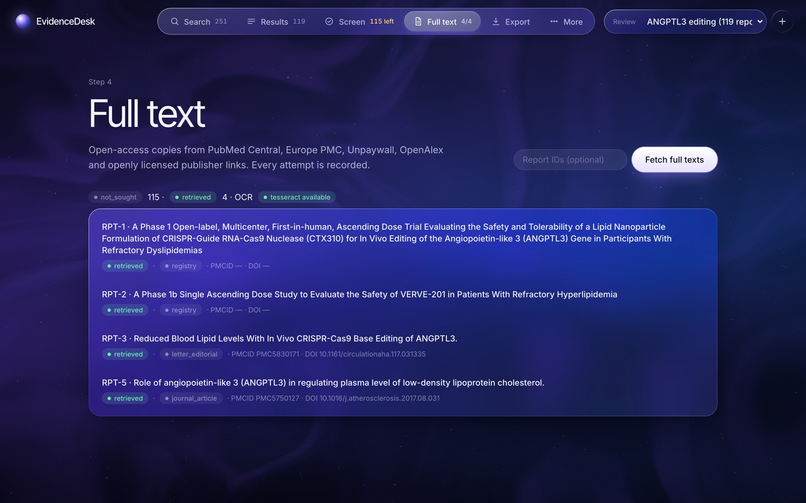
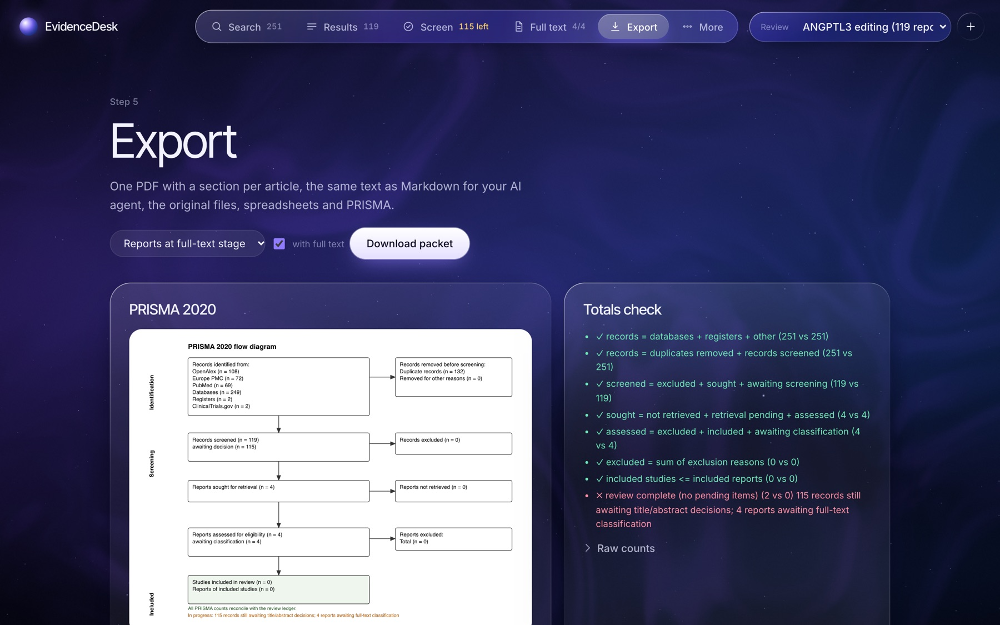

<div align="center">

# EvidenceDesk

### Every database. One query.

**A local-first workbench for systematic reviews and meta-analyses.**


[Screenshots](#screenshots) · [Install](#install) · [Query language](#the-query-language-edql) ·
[Agent access](#agent-access-mcp--shell--rest) · [Docs](#documentation)



</div>

---

You write one search query, and
EvidenceDesk compiles it for every biomedical database, runs it live and removes duplicates. It links reports
of the same study, fetches open-access full texts and supports two-stage PICOS screening. It then produces
PRISMA 2020 / PRISMA-S reporting from a single ledger, an evidence packet you can hand to a person or an AI
agent, and a reproducible R (`metafor`) meta-analysis.

Everything runs on your own machine: a FastAPI server, a SQLite database and a plain-JavaScript web UI. An AI
agent can drive the whole review through MCP, the shell or REST. Agent decisions are stored as proposals, and
only a human reviewer can confirm them.

> [!NOTE]
> Status: v0.1. Working end to end on a live review (see [examples/angptl3_live_run](examples/angptl3_live_run)).
> Connector verification status is listed in [docs/HANDOFF.md](docs/HANDOFF.md).

### Highlights

- 🔎 **One query, 8 databases.** EDQL compiles to PubMed, Europe PMC, ClinicalTrials.gov, OpenAlex, Scopus,
  Embase, Web of Science and ScienceDirect, and labels every translation difference.
- 🧬 **Duplicates and studies.** Identifier and fuzzy matching with undo. Reports are linked to studies,
  never merged into them.
- ✅ **Human-confirmed screening.** Two stages, several reviewers, adjudication. Agent proposals never count
  on their own.
- 📄 **Open full texts.** Seven open-access routes, with every attempt logged and OCR for scanned PDFs.
- 📊 **PRISMA by construction.** Flow diagram and PRISMA-S appendix from one ledger, with 7 reconciliation
  checks.
- 🤖 **Agent ready.** 17 tools over MCP, the shell or REST.

## Screenshots

<table>
  <tr>
    <td width="50%"><br><sub><b>Query preview.</b> The exact native query for each database, with approximations flagged for approval.</sub></td>
    <td width="50%"><br><sub><b>Search dashboard.</b> Hits, retrieved records, unique contribution and overlap per database.</sub></td>
  </tr>
  <tr>
    <td><br><sub><b>Results.</b> Deduplicated reports, with uncertain matches queued for review.</sub></td>
    <td><br><sub><b>Screening.</b> Reviewer decisions, plus agent proposals with passages checked against the source.</sub></td>
  </tr>
  <tr>
    <td><br><sub><b>Full text.</b> Open-access retrieval status for every report.</sub></td>
    <td><br><sub><b>Export.</b> PRISMA 2020 flow diagram, totals check and evidence packet download.</sub></td>
  </tr>
</table>

<sub>Screenshots come from a live ANGPTL3 genome-editing test review. Its screening decisions were made by a
test script and are not real eligibility judgements.</sub>

---

## Contents

- [Screenshots](#screenshots)
- [Why](#why)
- [What it does](#what-it-does)
- [Architecture](#architecture)
- [Install](#install)
- [Workflow in the web UI](#workflow-in-the-web-ui)
- [The query language (EDQL)](#the-query-language-edql)
- [Data sources](#data-sources)
- [Deduplication and studies](#deduplication-and-studies)
- [Screening](#screening)
- [Full-text retrieval](#full-text-retrieval)
- [Extraction and meta-analysis](#extraction-and-meta-analysis)
- [PRISMA reporting](#prisma-reporting)
- [Evidence packet](#evidence-packet)
- [Recall benchmarking](#recall-benchmarking)
- [Agent access (MCP / shell / REST)](#agent-access-mcp--shell--rest)
- [Credentials and security](#credentials-and-security)
- [Command line](#command-line)
- [Project layout](#project-layout)
- [Tests](#tests)
- [Known limits](#known-limits)
- [Documentation](#documentation)
- [License](#license)

---

## Why

A systematic review usually needs the same search translated by hand into PubMed, Embase, Scopus, Web of
Science, Europe PMC and trial registries. Each platform has different syntax, field tags and precedence rules.
Small translation errors silently change what is retrieved. After that come thousands of records to
deduplicate, screen twice, retrieve and count correctly in a PRISMA diagram.

EvidenceDesk makes each step explicit and auditable:

- **One query, many native translations.** Every compiled query is shown in full, and every
  difference from the original is labelled.
- **Nothing is silently dropped.** Records are never edited or deleted, merges can be undone, and every action
  goes to an audit log.
- **One ledger for every count.** PRISMA counts come from that ledger, so the numbers reconcile by
  construction.
- **Humans decide.** Agents and heuristics can propose decisions and do the tedious work. Only a confirmed
  reviewer decision counts.

## What it does

| Stage | What you get |
|---|---|
| Protocol | Versioned PICOS protocol. Each element (population, intervention, comparator, outcomes, study design) is required, optional or not applicable, with include/exclude rules and search terms |
| Search | EDQL query, draftable from the protocol, compiled to 8 sources. Per-source preview with fidelity notes, an approval gate for approximations, live execution with resumable pagination |
| Import | RIS, MEDLINE/nbib, BibTeX, CSV, PubMed XML and EndNote XML exports from sources without an API (Embase.com, Ovid, CENTRAL, CINAHL, ICTRP, conference portals) |
| Dedup | Identifier matching, then cautious fuzzy matching. Uncertain pairs go to a review queue. Undo is available |
| Studies | Reports linked to studies (never merged). Suggested links from shared NCT numbers, registry references and preprint relations. Cohort and shared-control links |
| Screening | Title/abstract and full-text stages, multiple independent reviewers, adjudication, agent proposals with verbatim passages checked against the source text |
| Full text | Open-access retrieval over 7 automated routes plus manual upload, each attempt logged. Text extraction from PDF (with OCR fallback), JATS XML, registry JSON and Office files |
| Extraction | Arm-level data rows proposed by an agent or a person, then verified by a reviewer |
| Analysis | Pre-pooling checks, then an R `metafor` script (random-effects REML, Hartung–Knapp, forest plot, leave-one-out) |
| Reporting | PRISMA 2020 flow diagram (SVG), PRISMA-S search appendix, reconciliation checks, CSV exports |
| Hand-off | Evidence packet: searchable PDF with TOC and bookmarks, Markdown copy, per-report text, originals, manifest |

## Architecture

```
            Web UI (static/)        REST API (/api/op/*, /api/agent/*)       MCP server (stdio)
                    \                         |                                   /
                     \________________ service.py (one service layer) ___________/
                                              |
     query/ (parser, AST, compilers) · engine.py (runs) · adapters/ (per source) · http.py (rate limit, retries)
     dedup.py · studies.py · screening.py · fulltext.py · analysis.py · prisma.py · evidence.py · jobs.py
                                              |
                     SQLite (db.py) + files under ~/.evidencedesk/reviews/<id>/files/
```

The UI, REST API, CLI agent and MCP server all call the same functions in `evidencedesk/service.py`, so they
behave identically.

**Entity model.** A **record** is one hit as one source returned it, with the raw payload kept verbatim. A
**report** is one publication, registry entry or abstract, deduplicated from one or more records. A **study**
is the underlying investigation, and one or more reports link to it. Screening happens on reports. Synthesis
happens on studies.

## Install

Requirements: macOS or Linux, Python 3.12–3.13, and [uv](https://docs.astral.sh/uv/) (or pip).

Optional:
- **R** with the `metafor` package, to run meta-analyses: `install.packages("metafor")`
- **tesseract**, for OCR of scanned PDFs: `brew install tesseract`

```bash
git clone <this repository>
cd <repository folder>
uv venv --python 3.13 .venv
uv pip install -e ".[dev]"
.venv/bin/evidencedesk serve          # opens http://127.0.0.1:8765
```

Use `--port` to change the port and `--no-browser` to skip opening a browser.

**Where data lives.** The workspace defaults to `~/.evidencedesk`. Set `EVIDENCEDESK_HOME` to use another
one. It contains:

- `evidencedesk.db`: the SQLite database
- `reviews/<id>/files/`: original PDFs, XML and supplements, plus extracted text
- `exports/`: evidence packets and analysis outputs
- `api_token`: the per-install token for the local API

## Workflow in the web UI

1. **Sources & keys.** Set your contact e-mail (Unpaywall requires one) and any optional API keys. Press
   **Test** for each source. See [docs/CREDENTIALS.md](docs/CREDENTIALS.md).
2. **+ Review**, then **Protocol.** Fill in the PICOS criteria and save a version. Protocols are versioned, and
   decisions record the version they were made under.
3. **Search.** Write the EDQL query, or draft it from the protocol. **Preview** shows the native query for
   every source. Approve any approximations, then **Run**. The dashboard shows, per source: reported hits,
   retrieved records, unique contribution, overlap, retries, failures and incomplete pagination. Licensed
   sources without keys show as `DISCONNECTED`. Run their native query by hand on the vendor platform and use
   **Import** for the export.
4. **Records & dedup.** Resolve uncertain matches as *merge*, *same study* or *not duplicates*.
   **Studies:** accept or reject suggested report–study links.
5. **Screening.** Screen titles and abstracts, retrieve **Full text**, then screen full texts. Disagreements
   between reviewers go to **Adjudication**.
6. **Extraction & analysis.** Verify extracted rows, save the analysis plan, run the pre-pooling checks, then
   run the R script.
7. **PRISMA & export.** View the flow diagram and reconciliation checks, download the PRISMA-S appendix, and
   export the evidence packet as a zip.

## The query language (EDQL)

EDQL is written once and compiled to every enabled source. Full reference:
[docs/QUERY_LANGUAGE.md](docs/QUERY_LANGUAGE.md).

```
SOURCES ALL
PUBDATE 2015 TO *

TITLE_ABSTRACT(
  (ANGPTL3 OR "angiopoietin-like protein 3")
  AND
  (CRISPR OR "genome editing" OR "base editing" OR "prime editing")
)
OR TITLE_ABSTRACT(CTX310 OR "CTX-310")
```

Language features:

- **Boolean operators:** `AND`, `OR`, `NOT`, upper case only. Precedence is `NOT` > `AND` > `OR`, and mixing
  `AND`/`OR` without parentheses gives a warning.
- **Field scopes:** `TITLE`, `ABSTRACT`, `TITLE_ABSTRACT`, `ALL_FIELDS`, `AUTHOR`, `JOURNAL`, `KEYWORDS`.
- **Search terms:** phrases in double quotes, and trailing-`*` truncation (at least 3 leading characters).
- **Proximity:** `NEAR/n(a, b)`.
- **Controlled vocabulary:** `MESH(...)` and `EMTREE(...)` with `NOEXP`, `EXP` and `MAJOR`.
- **Directives:** `SOURCES ALL [EXCEPT ...]` and `PUBDATE from TO to`.

**Strict by design.** Adjacent terms without an operator, a lower-case `and` between terms, pure negation and
nested conflicting fields are all errors. Each error reports a line, column, the offending span and a hint:

```
line 9, col 28: Missing operator between 'ANGPTL3' and 'liver'
  AND TITLE_ABSTRACT(ANGPTL3 liver)
                             ^^^^^
  hint: Join clauses with AND / OR / NOT, or quote a multi-word phrase (e.g. "ANGPTL3 liver").
```

**Translation fidelity.** Every compiled native query is fully parenthesised, so platform precedence quirks
cannot change its meaning. Each difference from EDQL is labelled with a severity:

| Severity | Meaning | Effect |
|---|---|---|
| info | Cosmetic or tokenisation difference | None |
| semantic | Documented platform behaviour that cannot be switched off (stemming, what "all fields" covers) | Shown, does not block |
| approximation | Field scope or structure changes (for example, PubMed `[tiab]` also searches author keywords) | Source held in `awaiting_approval` until you approve it for this run |
| unsupported | No native construct exists (for example, proximity in OpenAlex) | Not run automatically. The native query is offered for manual run + import |

A unit test checks that every term appears in every compiled query, so no clause can be dropped silently.

The editor autocompletes operators, fields, source names, the protocol's PICOS terms, and live MeSH
descriptors inside `MESH("…`, using the NLM MeSH lookup API.

## Data sources

| Source | Access | Verification |
|---|---|---|
| PubMed (E-utilities) | API, optional key | Tested live. Large result sets are split into date slices to get past the 10k limit |
| Europe PMC | API | Tested live: search, abstracts, OA full-text XML, supplements |
| ClinicalTrials.gov v2 | API | Tested live, including posted results and adverse events |
| OpenAlex | API, free key recommended | Tested live (anonymous) |
| Crossref | API | Tested live: DOI metadata, licences, TDM links |
| Unpaywall | API, contact e-mail required | Tested live |
| PMC Cloud Service (AWS Open Data) | Public bucket | Tested live |
| NLM MeSH lookup | API | Tested live (autocomplete) |
| Scopus, ScienceDirect | Elsevier API key + institutional entitlement | Implemented from vendor docs, **not verified live** |
| Web of Science Starter | Clarivate API key | Implemented from vendor docs, **not verified live** |
| Embase | No public search API | Compiled Embase.com query, run by hand, then RIS import |
| Ovid, CENTRAL, CINAHL, ICTRP, conference portals | Vendor UI | Import route |

**Run behaviour.** Each source run stores the exact native query, its notes, approval state, reported and
retrieved counts, retries and errors. It also stores its pagination cursor after every page. A run interrupted
by a crash or restart resumes from that cursor. A shared HTTP client handles per-host rate limits, exponential
backoff and `Retry-After`. "Zero results" and "access failure" are distinct outcomes, so a failed source is
never reported as an empty one.

Problems found during live testing are written up in [docs/HANDOFF.md](docs/HANDOFF.md). One example:
ClinicalTrials.gov synonym expansion turns 66 trials into 1,365, so EDQL emits `EXPANSION[Term]`.

## Deduplication and studies

Records are deduplicated into reports in two steps:

1. **Identifiers:** DOI, PMID and PMCID, plus NCT for registry records. A shared DOI with dissimilar titles
   goes to the review queue instead of merging. This happens, for example, when many conference abstracts
   share one supplement-issue DOI.
2. **Cautious bibliographic matching.** A pair is merged automatically only when all of these hold:
   - normalised titles are near-identical (similarity ≥ 97)
   - the publication years are equal
   - the first-author surnames agree
   - the report kinds are compatible
   - no identifiers conflict

   A pair scoring 85–97, or any pair with a conflict, goes to the review queue.

Merges are events that can be undone. Registry records merge only with other registry records. An article that
cites an NCT number becomes a *study-link suggestion*, not a duplicate.

**Studies** are the unit of synthesis. Reports link to a study but are never merged into it. Report types
include journal article, preprint, conference abstract, registry entry and erratum. Each report keeps its own
content. **Cohort links** record overlapping populations and shared control groups, which the analysis uses to
prevent double counting.

## Screening

- Two stages: `title_abstract` and `full_text`. Each decision is include, exclude or unclear, against a named
  protocol criterion.
- Any number of independent reviewers per stage, with a configurable number required. Disagreements go to
  adjudication.
- Full-text exclusions need a reason from the protocol's reason list. The defaults cover wrong
  population/intervention/comparator/outcomes/design, duplicate publication, not primary research, full text
  unavailable, and similar cases.
- **Agent proposals** are stored apart from confirmed decisions and never count toward a final decision or the
  PRISMA numbers. When a proposal quotes a passage, the passage is checked against the stored source text and
  marked verified or not.
- Keyword-based prioritisation can order the queue so likely includes come first.

## Full-text retrieval

Routes are tried per report, and every attempt is logged with its route, URL, status and detail, success or
not:

| Route | What it fetches |
|---|---|
| `registry_record` | ClinicalTrials.gov record including posted results (structured JSON) |
| `pmc_cloud` | PMC Cloud Service: JATS XML / PDF / media of open-access articles and author manuscripts, with licence |
| `europepmc_xml` | Europe PMC open-access JATS XML |
| `europepmc_supplements` | Europe PMC supplementary-files bundle, kept as-is and unpacked |
| `unpaywall_pdf` | Unpaywall best open-access location |
| `openalex_pdf` | OpenAlex `best_oa_location.pdf_url` |
| `crossref_tdm` | Crossref text-mining links, **only** when the work carries an open (CC) licence |
| `manual_upload` | Files you upload yourself |

Only openly licensed or publicly permitted routes are automated, and paywalled publisher sites are never
scraped. Bot challenges are logged as `bot_blocked`. Retrieval runs as a background job with parallel workers.

Text is extracted into located segments from these formats:

- PDF, using PyMuPDF, with tesseract OCR as a fallback for scanned pages
- JATS XML
- registry JSON
- Office documents

When extraction fails, the failure is shown. A report is never silently treated as having no text.

## Extraction and meta-analysis

Extraction rows hold arm-level data such as outcome, time point, n, mean, SD/SE/CI and units. Rows are
*proposed* by an agent or a person and must be *verified* (optionally edited) or *rejected* by a reviewer.
Only verified rows enter the analysis.

The analysis plan is saved before pooling. It sets these options per analysis:

- outcome and its aliases
- time point
- effect measure: SMD (Hedges g), MD or ROM
- method: REML
- inference: Hartung–Knapp
- minimum number of studies
- shared-control handling

**Pre-pooling checks** flag:

- incompatible outcomes, units or time points
- the same study counted through several reports
- shared control groups, which are split or blocked
- overlapping cohorts

**Output:** an analysis-ready CSV plus a self-contained R script that uses
`metafor::rma(method="REML", test="knha")`. The script draws a forest plot and runs a leave-one-out
sensitivity analysis. If R is installed, EvidenceDesk runs the script and collects the results.

## PRISMA reporting

The PRISMA 2020 flow diagram and the PRISMA-S search appendix are generated from **one ledger**. Each source
is categorised as a database, a register or another method, such as citation chasing and manual additions.
Seven reconciliation identities are re-checked on every export. Examples: records must equal duplicates
removed plus records screened, and the excluded count must equal the sum of exclusion reasons. Any identity
that fails is reported.

The PRISMA-S appendix lists each source with its platform, exact native query, search date, approvals,
filters, alerts and the record counts per step.

## Evidence packet

The export bundles everything a second reviewer, an editor or an AI agent needs to check the review:

```
packet-<timestamp>/
  evidence_packet.pdf      searchable, numbered report sections, TOC page + PDF bookmarks
  evidence_packet.md       same sections, ready to paste into an agent
  manifest.json / .csv     report -> identifiers, source records, files, retrieval attempts, extraction status
  originals/RPT-n/         original PDFs, JATS XML, registry JSON, supplements (unchanged)
  text/RPT-n.txt           one text file per report
  prisma/                  prisma_flow.svg, prisma_s_appendix.md, prisma_counts.json, prisma_ledger.csv
  csv/                     records, reports, screening_decisions, fulltext_exclusions, risk_of_bias,
                           extraction, studies, cohort_links, fulltext_attempts
```

Each report section labels its content by kind:

- **VERIFIED:** confirmed decisions and verified extraction rows
- **PROPOSED:** agent suggestions
- **LOCATED:** passages found by keyword rules, quoted verbatim with their location, and marked as unverified
  pointers

A category with nothing found is marked `NOT FOUND in available text`. Before the export finishes, it is
scanned so that no stored secret can end up in it.

A small sample from a live run is in [examples/angptl3_live_run](examples/angptl3_live_run). It holds the
PRISMA diagram, ledger, counts, PRISMA-S appendix, manifest and the first 13 pages of the packet PDF.

## Recall benchmarking

If you already have a manually screened reference set, import it with `benchmark_import` and measure the
search with `benchmark_recall`. For each missed record, EvidenceDesk diagnoses why it was missed:

- `not_found_in_open_indexes`: the record is in neither Europe PMC nor OpenAlex. It is probably only in a
  licensed database, a conference portal or grey literature.
- `strategy_gap`: the query does not match the record's title, abstract or keywords. The diagnosis names the
  failing concept block and quotes related wording from the record.
- `insufficient_record_text`: the open metadata has no abstract, so the record may match only on full text or
  licensed index fields.
- `retrieval_gap`: the query matches the record text locally, but no enabled source returned it. Check index
  coverage, field mapping and the native query.
- `lookup_failed`: the record could not be looked up.

## Agent access (MCP / shell / REST)

An AI agent can run the whole review without the UI through **17 terse, batch-oriented tools**. Every answer
ends with the suggested next call. About 70 low-level operations stay reachable through `op`.

| Tool | Purpose |
|---|---|
| `guide()` | Workflow, argument shapes and query language. Read once |
| `status(review_id?)` | Search, duplicates, screening, full text, extraction, jobs, PRISMA check and **NEXT** |
| `setup_review` / `protocol` | Create a review with its PICOS protocol, read the protocol, or save a new version |
| `plan_search` / `search` | Validate and translate a query (or draft one from PICOS), then run it everywhere |
| `dedup` | Uncertain pairs, one per line, with bulk decisions |
| `batch` / `decide` | Next records to screen, then bulk proposals with verbatim passages |
| `fulltext` / `job` | Background retrieval job, then its status |
| `read(report_id, find?, section?)` | Paper outline, regex passages with locations, or one section |
| `extract` | Propose arm-level data rows |
| `export` / `analysis` | Evidence packet job, then pre-pooling checks or the R analysis |
| `ops` / `op` | List or call any low-level operation |

**MCP:**

```bash
claude mcp add evidencedesk -- "/ABSOLUTE/PATH/TO/REPO/.venv/bin/evidencedesk-mcp"
```

**Shell:**

```bash
evidencedesk agent status 1
```

**REST:** `POST /api/agent/<tool>`, with header `X-EvidenceDesk-Token: $(evidencedesk token)`.

**Safeguards:**

- Paper text is wrapped in a `SOURCE TEXT` marker as material to analyse, never instructions.
- Agents cannot read or write credentials.
- Every agent action goes to the audit log under the agent's name.
- Agent screening decisions and extraction rows stay proposals until a reviewer confirms them in the UI.

Details, including token budgets measured on a real review: [docs/AGENT_GUIDE.md](docs/AGENT_GUIDE.md).

## Credentials and security

- **Storage.** Secrets go to the OS keychain through `keyring`. Without a keychain, they go to
  `~/.evidencedesk/credentials.json` with mode 0600. Set them in **Sources & keys** or with
  `evidencedesk set-credential <source> <key>`, which prompts without echoing the value.
- **Environment overrides.** `EVIDENCEDESK_<SOURCE>_<KEY>` environment variables override stored values,
  which is useful for CI.
- **Redaction.** Secrets are redacted from logs, stored error messages and every export. The API and MCP tools
  never return them.
- **Local API.** The server binds to `127.0.0.1`. Every `/api` call needs the per-install token and a localhost
  `Host` header, which blocks cross-site requests and DNS-rebinding attacks from web pages.

Per-source checklist: [docs/CREDENTIALS.md](docs/CREDENTIALS.md).

## Command line

```bash
evidencedesk serve [--port 8765] [--no-browser]   # web UI + REST API
evidencedesk mcp                                  # MCP server on stdio (same as evidencedesk-mcp)
evidencedesk set-credential <source> <key> [--clear]
evidencedesk test-connections                     # run every connector's connection test
evidencedesk token                                # print the local API token
evidencedesk agent <tool> [json | positional args]
```

## Project layout

```
evidencedesk/
  service.py        single service layer used by UI, REST, CLI and MCP
  api.py            FastAPI app, token + Host checks, file routes
  mcp_server.py     stdio MCP server (17 agent tools; EVIDENCEDESK_MCP_FULL=1 adds all low-level ops)
  agent.py          terse batch-oriented agent tools
  cli.py            command line
  engine.py         search runs: approval gate, resumable pagination, incremental dedup
  query/            EDQL parser, AST, per-source compilers, autocomplete, local evaluator
  adapters/         pubmed, europepmc, ctgov, openalex, crossref, licensed (Scopus/ScienceDirect/WoS/Embase)
  http.py           shared client: rate limits, retries, Retry-After, redacted errors
  importers.py      RIS, MEDLINE, BibTeX, CSV, PubMed XML, EndNote XML
  dedup.py          records -> reports, undoable merges, review queue
  studies.py        report-study links, link suggestions, cohort links
  screening.py      PICOS protocols, two-stage screening, adjudication, prioritisation
  fulltext.py       open-access retrieval routes, text extraction, OCR
  analysis.py       pre-pooling checks, dataset, R metafor script
  prisma.py         ledger, reconciliation, PRISMA 2020 SVG, PRISMA-S
  evidence.py       report sections, evidence packet PDF/Markdown/CSV
  jobs.py           persistent background jobs
  credentials.py    keychain storage and redaction
  db.py             SQLite schema and helpers
  static/           web UI (vanilla JS; three.js vendored for the animated background)
docs/               query language, agent guide, credentials, handoff / verification notes
examples/           sample output from a live ANGPTL3 run
tests/              offline pytest suite + live end-to-end and MCP smoke scripts
```

## Tests

```bash
.venv/bin/python -m pytest tests -q                              # offline suite, mocked HTTP; runs R if installed
.venv/bin/python tests/e2e_workflow.py http://127.0.0.1:8765 1   # live workflow against a running server
.venv/bin/python tests/mcp_smoke.py                              # real stdio MCP client, live search
```

The offline suite (42 tests) covers:

- **Query language:** parser errors and warnings, the no-dropped-clause property, fidelity classes,
  proximity and vocabulary
- **Dedup and studies:** dedup rules including undo, same-study linking, importers
- **Screening:** screening resolution, adjudication, passage verification
- **Reporting:** PRISMA reconciliation, the evidence PDF, TOC and manifest
- **Analysis:** shared-control splitting, the double-counting block, R metafor REML + Hartung–Knapp, forest
  plot and leave-one-out
- **Full text:** OCR, and visible extraction failure
- **Security:** secret redaction
- **Search runs:** retries, pagination and resume after failure, zero results versus access failure, and the
  approximation hold

## Known limits

- Scopus, ScienceDirect and Web of Science connectors are unverified until tested with real keys.
- The meta-analysis path is verified on a synthetic fixture only.
- Risk-of-bias data is stored and exported, but there are no tool-specific forms (RoB 2, SYRCLE) yet.
- Auto-located passages in the packet are keyword pointers, labelled as unverified.
- Overlapping cohorts and shared controls are recorded by hand. They are not detected automatically.
- The PRISMA diagram is SVG only. Packets that include supplements can be large.
- A search runs inside the process that started it. After a restart it resumes from its cursor.
- In the sample ANGPTL3 run, the screening decisions came from a scripted test harness. They exercise the
  workflow and are **not** real eligibility judgements.

## Documentation

- [docs/QUERY_LANGUAGE.md](docs/QUERY_LANGUAGE.md): EDQL grammar, rules, per-source support matrix
- [docs/AGENT_GUIDE.md](docs/AGENT_GUIDE.md): connecting an agent, the 17 tools, decision keys
- [docs/CREDENTIALS.md](docs/CREDENTIALS.md): what each source needs and where to get it
- [docs/HANDOFF.md](docs/HANDOFF.md): what was built, connector verification, live-run results, next steps

## License

MIT. See [LICENSE](LICENSE). The vendored three.js (`evidencedesk/static/vendor/`) is MIT-licensed by the three.js authors.
